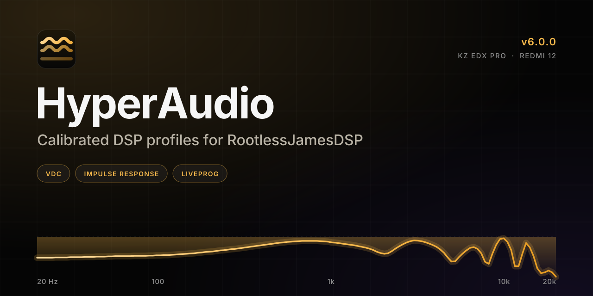

<div align="center">
  
  
  <br>
  
  <h1>HyperAudio</h1>
  
  <p><strong>Calibrated DSP profiles for RootlessJamesDSP.</strong></p>
  
  <p>
    <a href="https://nmstudioo.github.io/HyperAudio/"><strong>Live Site</strong></a> &nbsp;·&nbsp;
    <a href="site/docs/">Documentation</a> &nbsp;·&nbsp;
    <a href="docs/METHOD.md">Method</a> &nbsp;·&nbsp;
    <a href="docs/EVIDENCE.md">Evidence</a>
  </p>
  
  <p>
    
    
  </p>
</div>

---

## Repository Structure

```text
HyperAudio/
├── .github/workflows/   # CI (layout gates, links) and Pages deployment
├── build/               # Build scripts (build.py, response.py, docs_site.py)
├── candidates/          # Experimental profiles
├── docs/                # Source Markdown (rendered to site/docs/)
├── releases/            # Frozen, versioned releases (v5.0.0)
├── site/                # The live web interface (HTML/CSS/JS)
├── src/                 # Source DSP profiles and metadata
├── tests/               # Validation (check.py, eel/, overflow.js, links.js)
├── tools/               # Formatters and CI patchers
├── index.html           # Root redirect to /site/
├── VERSION              # Current version string
└── README.md            # This file
```

Rebuild & Test

```bash
# 1. Rebuild the site, docs, and artifacts
python3 build/build.py
python3 build/docs_site.py

# 2. Run static checks (syntax, structure, links, docs freshness)
python3 tests/check.py

# 3. Run layout gates (requires Playwright)
node tests/overflow.js
```

<br>
<div align="center">
  
  <br>
  <sub>Designed &amp; tuned by <b>Noushad M.</b> - © 2026 HyperAudio</sub>
</div>
