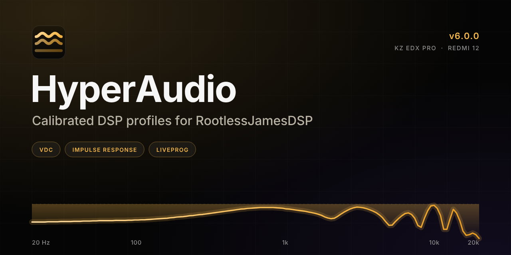
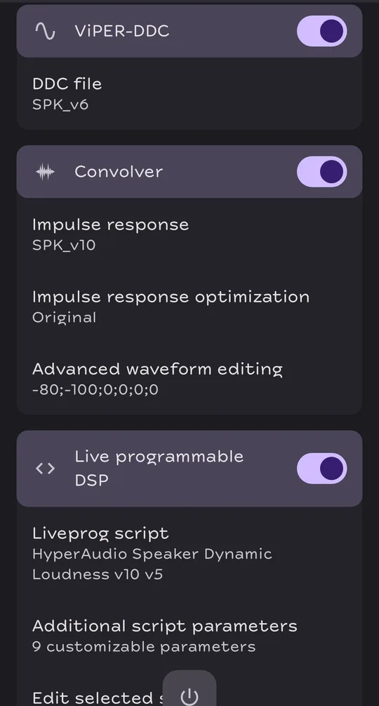
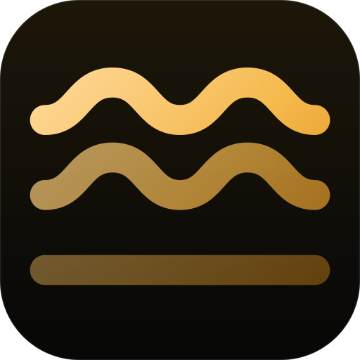

<p align="center">

</p>

<p align="center">
<a href="https://nmstudioo.github.io/HyperAudio/"></a>
<a href="releases/6.1.0/HyperAudio_6.1.0_all.zip"></a>
</p>

<p align="center">


</p>

<p align="center">
Six calibrated profiles for two devices. Each one is a VDC, an impulse response<br>
and a Liveprog limiter, tuned together and checked before it ships.
</p>

## The chain

Every profile is three files, loaded in RootlessJamesDSP in this order.

| Stage | Job |
|:--|:--|
| **1. VDC** `.vdc` | Biquad banks at 44.1 and 48 kHz, fitted to the same predicted curve |
| **2. Convolver** `.irs` | Convolution: 4-channel true-stereo for IEM, 2-channel for speaker |
| **3. Liveprog** `.eel` | Input guard, 1.5 ms lookahead limiter, true-peak guard, per-profile controls |

Each chain is normalised to a maximum gain of −0.5 dB, and the limiter protects the peaks. Details are in [Method](docs/METHOD.md).

## Profiles

**KZ EDX Pro** · in-ear

| Profile | Character |
|:--|:--|
| **HD** | True-stereo four-channel IRS with light crossfeed (−12.5 dB at 500 Hz). 4 controls. |
| **Spatial V4** | HRIR-style crossfeed, 0.3 ms inter-aural delay, Binaural Width 50 to 150 %. 5 controls. |
| **Reference V10** | Dual-mono, no crossfeed; the VDC carries the correction. 4 controls. |

**Redmi 12** · speaker

| Profile | Character |
|:--|:--|
| **Protection V6** | The IRS carries the correction; one 110 Hz high-pass protects the micro-speaker. 5 controls. |
| **Cinema V8** | Centre Dialogue Boost and Surround Stage Width on a VDC-led correction. 7 controls. |
| **Dynamic V10** | Peak-hold compressor, virtual bass harmonics and loudness makeup. 9 controls. |

Not sure which one? Use the [finder](https://nmstudioo.github.io/HyperAudio/finder.html) or [compare](https://nmstudioo.github.io/HyperAudio/compare.html) all six on the site.

## Install

1. Download a profile zip below, or the bundle of all six.
2. **ViPER-DDC:** load the profile's `.vdc`.
3. **Convolver:** load its `.irs` with optimisation set to **Original**.
4. **Liveprog:** load its `.eel` and leave **True Peak Detect** on.

Keep the Convolver preamp and the EEL post gain at 0 dB.

<p align="center">

</p>

## Evidence

Claims come in three tiers that are never mixed.

- **Offline, automated.** 19 checks on each of 6 builds in [`acceptance.json`](releases/6.1.0/acceptance.json): 108 pass, 0 warn, 6 not run (`cpu`).
- **Device-reported.** Author-reported listening passes for all six builds are recorded in [`device-tests.json`](docs/evidence/device-tests.json). They are not instrument measurements.
- **Acoustic measurement.** None. Every curve is **calculated**, not measured.

The limits worth knowing: speaker boost is capped at +8 dB, true-peak overshoot is at most +0.25 dB (calculated, 8x oversampling), and no bank exists for sample rates other than 44.1 and 48 kHz. All are listed in [Limits](docs/LIMITS.md).

## Downloads

| Package | Size |
|:--|--:|
| [**All six profiles**](releases/6.1.0/HyperAudio_6.1.0_all.zip) | 58.4 KB |
| [KZ EDX Pro · HD](releases/6.1.0/HyperAudio_6.1.0_iem-hd.zip) | 27.8 KB |
| [KZ EDX Pro · Spatial V4](releases/6.1.0/HyperAudio_6.1.0_iem-v4.zip) | 3.2 KB |
| [KZ EDX Pro · Reference V10](releases/6.1.0/HyperAudio_6.1.0_iem-v10.zip) | 3.7 KB |
| [Redmi 12 · Protection V6](releases/6.1.0/HyperAudio_6.1.0_spk-v6.zip) | 9.4 KB |
| [Redmi 12 · Cinema V8](releases/6.1.0/HyperAudio_6.1.0_spk-v8.zip) | 11.5 KB |
| [Redmi 12 · Dynamic V10](releases/6.1.0/HyperAudio_6.1.0_spk-v10.zip) | 4.3 KB |

Changes from the previous release are listed in `releases/6.1.0/DIFF.md`. To verify the files in `releases/6.1.0/`:

```bash
cd releases && sha256sum -c 6.0.0/SHA256SUMS.txt
```

## Documentation

| Read | For |
|:--|:--|
| [Method](docs/METHOD.md) | How a profile is built and what the curves mean |
| [Evidence](docs/EVIDENCE.md) | The three evidence tiers and the v6 results |
| [Limits](docs/LIMITS.md) | What the profiles do not do, and what would change it |
| [Open items](docs/OPEN.md) | Everything still unfinished, and what each item needs |
| [44.1 kHz refit](docs/refit44_report.md) | The matched-bank refit report |
| [Reproduce](docs/REPRODUCING.md) | Rebuild and verify from source |
| [Releasing](docs/RELEASING.md) | Cut and freeze a release |
| [Changelog](docs/CHANGELOG.md) | What changed in each version |

The same docs are rendered on the [live site](https://nmstudioo.github.io/HyperAudio/docs/).

## Repository

```text
HyperAudio/
├── site/          Live web interface (HTML, CSS, JS) and downloads
├── releases/      Frozen, versioned releases with checksums (6.1.0, 6.0.1, 6.0.0, 5.0.0)
├── src/           Source profiles and metadata
├── docs/          Source Markdown, rendered to site/docs/
├── build/         build.py, response.py, docs_site.py, stamp.py, seo.py
├── tests/         check.py, eel/, a11y.js, overflow.js, links.js
├── tools/         Formatter and JS verifier
├── .github/       CI, Pages and release workflows
├── VERSION        Current version string
└── index.html     Root redirect to /site/
```

## Rebuild

```bash
python3 tools/ship.py            # regenerate derived files, then gate
python3 tools/ship.py --release  # full build, freeze, gate
node tests/overflow.js        # layout gates (needs Playwright)
```

<p align="center">

<br>
<sub>Designed and tuned by <b>Noushad M.</b> · © 2026 HA</sub>
</p>
