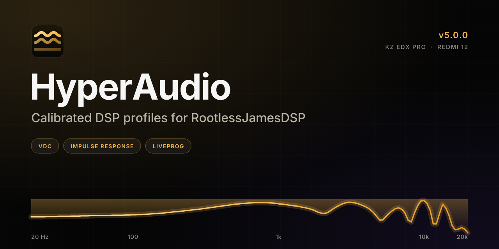

<p align="center"></p>

# HyperAudio v5.0.0

Static site and downloads for six DSP profiles (RootlessJamesDSP order: VDC, then Convolver, then Liveprog).

```
index.html                 page markup
manifest.webmanifest       web app manifest (installable page)
favicon.ico, robots.txt
assets/brand/              logo.svg, logo-light.svg, logo-mark.svg, github-cover.svg/.png, og-image.svg/.png
assets/icons/              favicon, apple-touch, 192/512 and maskable PNG icons
tools/make_brand.py        regenerates every brand asset (text is outlined, data from profiles.json)
assets/css/main.css        original styles (unchanged)
assets/css/site.css        v5 additions
assets/js/theme-init.js    theme before paint
assets/js/chart.js         response chart (window.HAChart)
assets/js/app.js           page logic, reads data/profiles.json
data/profiles.json         single source of truth: profiles, files, SHA-256, curves
downloads/v5.0.0/<id>/     VDC + IRS + EEL per profile
downloads/v5.0.0/*.zip     per-profile bundles and all-in-one
downloads/v5.0.0/SHA256SUMS.txt
```

Profiles: iem-hd, iem-v4, iem-v10 (KZ EDX Pro); spk-v6, spk-v8, spk-v10 (Redmi 12).

Serve over HTTP (`python3 -m http.server`); `file://` blocks the JSON fetch.
To release a new version, replace the files, update `data/profiles.json` and `SHA256SUMS.txt`.

## Evidence and limits
- Offline-verified: file validity, VDC/IRS fit, EEL compile and limiter tests in a VM.
- Device-reported: no crackle on speaker profiles; IEM passed; True Peak Detect on.
- Speaker boost is capped at +8 dB (and high-passed below 110 Hz), so speaker curves sit below the uncapped target at 100–2000 Hz by design.
- Predicted-response curves are calculated, not acoustic measurements.

## Brand assets
Set `assets/brand/github-cover.png` (1280×640) as the repository social preview in Settings > General. Run `python3 tools/make_brand.py` to rebuild all assets; it needs fontTools, Pillow, Playwright and the Inter font.
